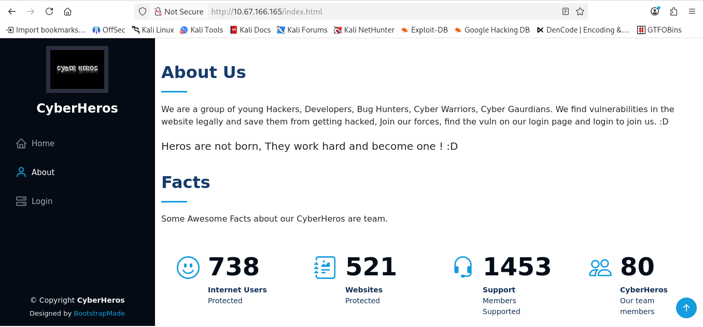
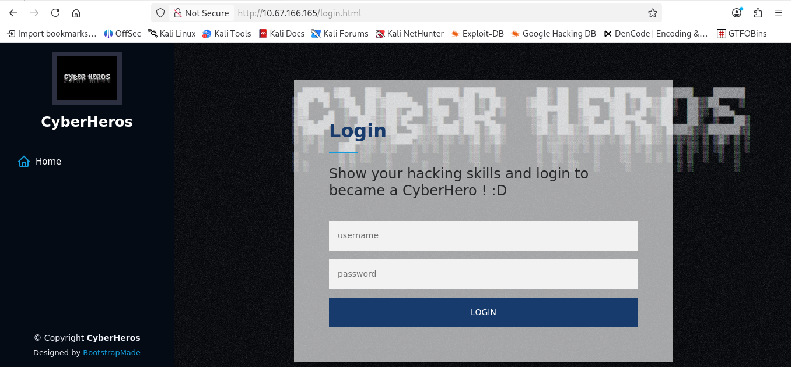
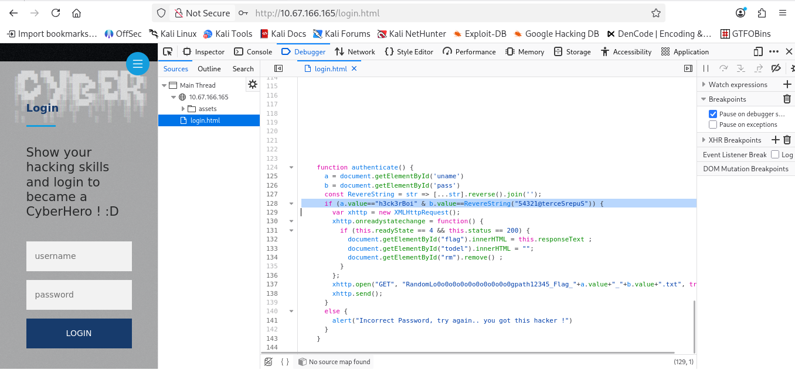
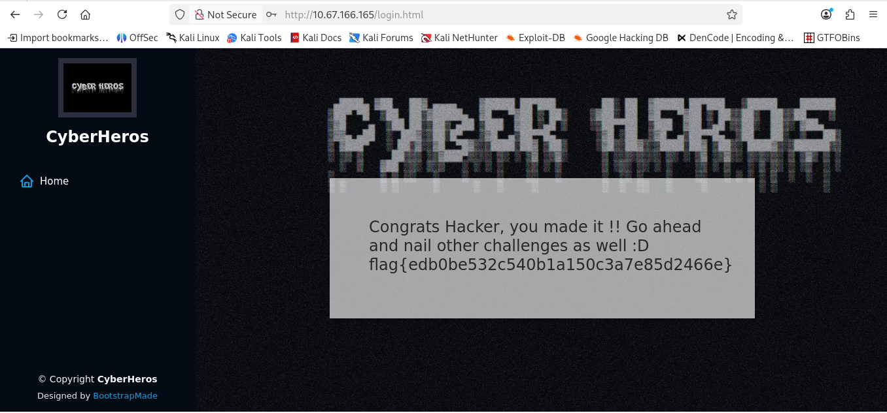

# CyberHeroes

**Link:** https://tryhackme.com/room/cyberheroes
**Dificuldade:** Easy
**Data:** 2026-10-11

---

## Etapa 1



Começamos abrindo o site e explorando sua estrutura. A página inicial apresenta informações sobre o grupo CyberHeros.



Ao navegar até a página de login, encontramos um formulário solicitando usuário e senha.

## Etapa 2

Por se tratar de uma página HTML estática, abrimos o DevTools com `F12` e acessamos a aba **Debugger** para analisar o código-fonte.



Analisando o código, encontramos duas credenciais hardcoded:

> **Username:** `h3ck3rBoi`  
> **Password:** `SuperSecret@12345` (estava escrita de forma reversa no código)

## Etapa 3

Com as credenciais em mãos, inserimos o username e a senha no formulário de login — e obtivemos acesso à flag diretamente na tela:



---

## Flag

```
flag{edb0be532c5401a150c3a7e85d2466e}
```

---

## Conclusão

O desafio explora uma vulnerabilidade de **exposição de credenciais no código-fonte** (client-side). A senha estava armazenada diretamente no HTML/JS da página, apenas com uma ofuscação simples (string reversa), o que não oferece nenhuma proteção real. Sempre inspecione o código-fonte de páginas de login em CTFs.
